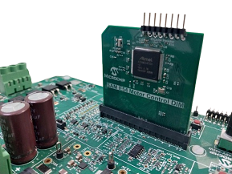
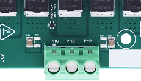
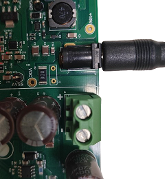
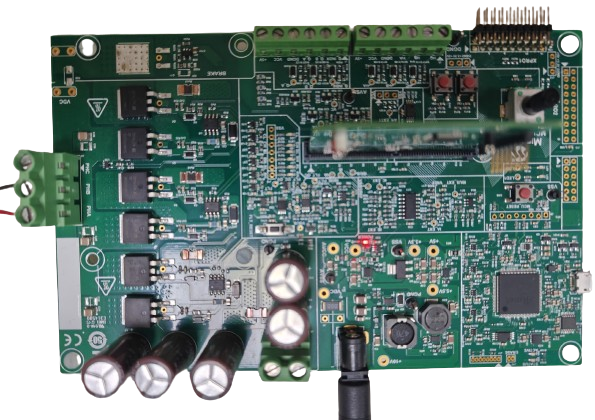

# MCLV 48V 300W Development Board
## Setting up the hardware

Following hardware is used for the demonstration.
- [MCLV 48V 300W Development Board](https://www.microchip.com/en-us/development-tool/ev18h47a)
- [ATSAME54 DIM](https://www.microchip.com/en-us/development-tool/EV24X01A)
- ACT57BLF02

### Setting up [MCLV 48V 300W Development Board](https://www.microchip.com/en-us/development-tool/ev18h47a)

- Insert the PIC32MK MCA Motor Control Dual In-Line Module on J8 interface header.

  

    
  

- Motor Connections: Connect the 3 Phase connections of the motor on the J4 header.

  

    
  

- Power the board with a 24V DC supply using J1 or J3(+,-) header. For additional safety, it is recommended to use a current limited power supply while testing this software demonstration on a non-default hardware and motor.

  

    
  

- Complete Setup

  

    
  

## Running the Application

1. Build and Program the application using its IDE
2. Press switch SW2 to start the motor
3. Vary potentiometer to change the speed of the motor
4. Press switch SW2 to stop the motor
5. Press switch SW1 to change the direction of the motor
6. Press switch SW2 again to start the motor
7. Monitor graphs on X2C Scope

Refer to the following tables for switch and LED details:

| Switch | Description |
|------|----------------|
| Switch SW2 | To start or stop the motor |
| Switch SW1 | To change the direction of rotation.  Direction toggle command is accepted only when motor is stationary. |
||

| LED D3 Status | Description |
|------|----------------|
| OFF  | Motor spin direction is "positive"  |
| ON  | Motor spin direction is "negative"   |
||

| LED D4 Status | Description |
|------|----------------|
| OFF  | No fault  |
| ON   | Fault is detected  |
||

**Note**: For ZSMT projects, the mid-point of potentiometer represents the zero point.