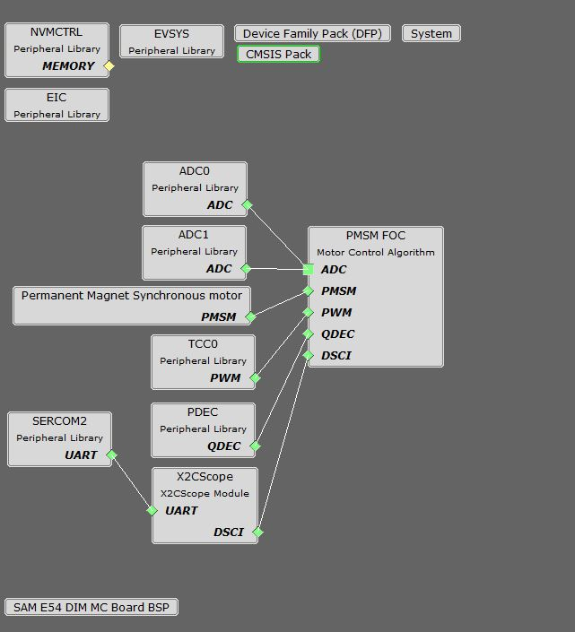

# FOC Based Position Control of PMSM Using Quadrature Encoder

This motor control example project shows how to control the position of Permanent Magnet Synchronous Motor (PMSM) using an Encoder based Field Oriented Control (FOC) on SAME54 Micro-controller.

## Description
The permanent magnet synchronous motors ( PMSM ) is widely used in various industries due to its high power density, smaller size and high efficiency. The Field oriented control is one of the most popular control mechanisms for the PMSM motor for applications which requires high dynamic performance.

This example shows how to configure motor control peripherals ADC, PDEC and TCC for the control operation. The control strategy is the sensored FOC, in which rotor position is determined by the Quadrature Encoder. Position is obtained using quadrature encoder and speed is calculated from the position.

Waveforms and variables can be monitored at runtime using X2CScope. 

Key features enabled in this project are:

- Dual shunt current measurement
- Speed control loop
- Position control loop

## MCC Project Configurations

- **ADC0-ADC1**: 

   ADC0 and ADC1 are setup to operate in Master - Slave mode with ADC0 acting as a Master

   Both ADCs convert single ended inputs. Phase U current is sampled and converted by ADC0 and Phase V current is sampled and converted by ADC1

   Both ADCs are hardware triggered simultaneously by an event generated from TCC0 at the end of each PWM cycle

   Conversion Ready interrupt is generated by ADC0. Since both ADCs are triggered simultaneously and have the same resolution and sampling time, both ADCs complete conversion at the same time

- **TCC0**: 

    This peripheral is used to generated three phase synchronous PWM waveforms. Fault functionality is also enabled to switch off the output waveforms asynchronously.
- **PDEC Peripheral**:

    It is used to decode the rotor position and speed from quadrature encoder signals.
- **EIC**:

    External Interrupt Controller detects a hardware over-current fault input and generates a non-recoverable fault event for TCC0, thereby shutting down the PWM in the event of an over-current fault
- **EVSYS**:

    Event System acts as an intermediary between event generator and event users

    Event generated by the TCC0 when the counter reaches TOP, is used by the ADC0 as a hardware trigger source via the Event System

    Event generated by the EIC upon over-current fault, is used by the TCC0 as a non-recoverable fault event via Event System
- **SERCOM2**:

    SERCOM2 is configured in USART mode and is set to operate at 115200 bps

    This USART channel is used by the X2CScope plugin to plot or watch global variables in run-time. Refer to X2C Scope Plugin section for more details on how to install and use the X2CScope

## Project Details
This project has been created using Harmony QSpin Tool. For details refer [Harmony QSpin](https://microchip-mplab-harmony.github.io/motor_control/index.html)

## Downloading and building the application

To clone or download this application from Github, go to the [main page of this repository](https://github.com/Microchip-MPLAB-Harmony/mc_apps_sam_d5x_e5x) and then click **Clone** button to clone this repository or download as zip file.
This content can also be downloaded using content manager by following these [instructions](https://github.com/Microchip-MPLAB-Harmony/contentmanager/wiki).

Path of the application within the repository is **apps/pmsm_foc_zsmt_hybrid_sam_e54** .

To build the application, refer to the following table and open the project using its IDE.

| Project Name      | Description                                    | Demo User Guide |
| ----------------- | ---------------------------------------------- | -------------- |
| qspin_position_control.X | MPLABX project for MCLV-48V-300W board with ATSAME54 DIM | [Hardware Setup and Running The Application on MCLV-48V-300W with ATSAME54 DIM](../docs/mclv_atsame54_dim_position_encoder.md) |